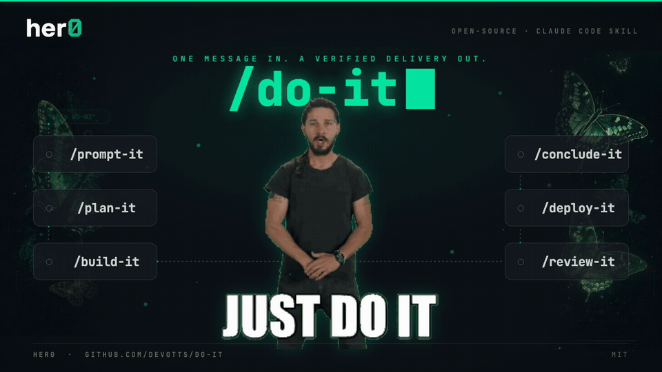
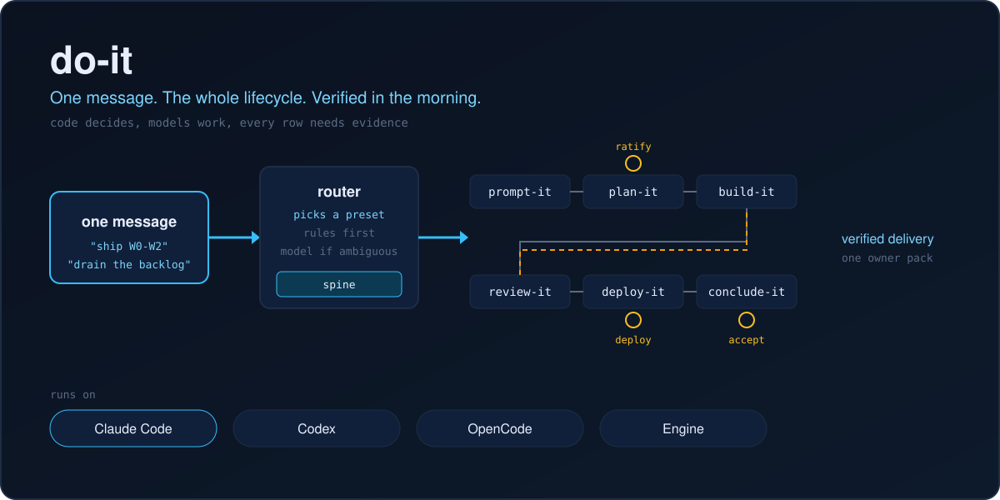
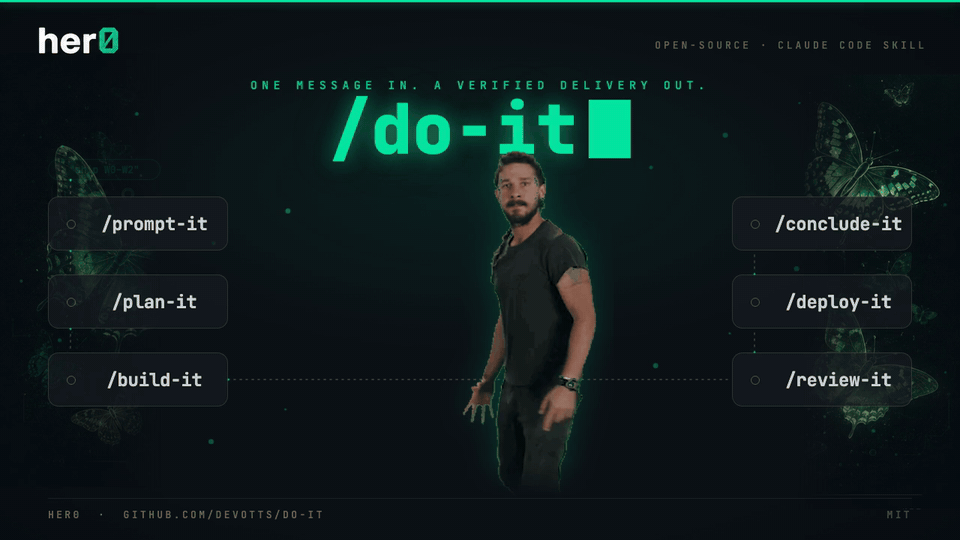

<div align="center">

<picture>
  <source media="(prefers-reduced-motion: reduce)" srcset="assets/marketing/final/a-clip1-header-poster.png">
  
</picture>

<h1>do-it</h1>

<h3><strong>One message in. A verified delivery out.</strong></h3>

Hand it a request and walk away. do-it picks the right lifecycle, asks you every question **once**, and keeps going until **every acceptance row is VERIFIED, PARKED with a question, or BLOCKED with a reason**.

<em>The conductor above the *-it family: plan-it plans it, build-it builds it, review-it reviews it, and do-it runs them as one.</em>

<a href="#how-it-works"></a>

<a href="#installation"></a>
<a href="LICENSE"></a>


<a href="https://github.com/DevOtts"></a>
<a href="https://github.com/DevOtts/do-it/releases/latest"></a>

<a href="#installation">Install</a>&nbsp;·&nbsp;<a href="#the-bottleneck-it-kills">Why</a>&nbsp;·&nbsp;<a href="#how-it-works">How it works</a>&nbsp;·&nbsp;<a href="#whats-inside">What's inside</a>&nbsp;·&nbsp;<a href="#platform-compatibility">Platforms</a>&nbsp;·&nbsp;<a href="CHANGELOG.md">Changelog</a>

> [!NOTE]
> do-it is the conductor, not a replacement. The stages stay in their own repos: [prompt-it](https://github.com/DevOtts/prompt-it), [plan-it](https://github.com/DevOtts/plan-it), [build-it](https://github.com/DevOtts/build-it), [review-it](https://github.com/DevOtts/review-it) and [conclude-it](https://github.com/DevOtts/conclude-it). Each keeps working on its own.

> [!IMPORTANT]
> This is an early release. The README only states what a fixture measured; the [Status](#status) section lists what is verified and what is not.

</div>

---

AI coding agents are already good at the pieces. They write the plan, build the slice, review the diff, run the deploy. What still fails is the seam between the pieces: a question asked in the middle of the night, a review loop that never ends, a context window that fills up and forgets the finish line, a "done" with nothing behind it.

do-it is the missing step, packaged as one command. It routes your request to a preset, runs the stages in order on whatever harness you use, spends the cheapest model that can do each piece, and refuses to call a row done without evidence. The part that decides is code, not a model.

## The bottleneck it kills

The bottleneck is you. Every plan wants a confirmation, every review wants a ruling, every credential wants a hand. You sit between the stages and carry the state in your head.

With do-it you send one message before bed. The plan is written and every open decision is either resolved or defaulted with a recorded reason. The build runs against a visible finish line. Reviews converge by rule. The only things that stop the night are the real owner gates: production, credentials, spend, destructive actions, anything client-facing. Those wait for you, in one numbered pack, and the rest keeps moving.

In the morning you read one table. Each row says VERIFIED with the evidence file, or says exactly why not.

<a href="#how-it-works"></a>

## Installation

> [!TIP]
> Any agent that reads `SKILL.md` can use the universal installer:
> ```bash
> npx skills add DevOtts/do-it -a {agent}
> gh skill install DevOtts/do-it
> ```

### Claude Code (native)

```
/plugin marketplace add DevOtts/do-it
/plugin install do-it@devotts
```

Installing `do-it@devotts` installs the family through `dependencies`: prompt-it, plan-it, build-it, review-it and conclude-it. We checked this on a real Claude Code install and the host resolved all five.

### Codex

```bash
npx skills add DevOtts/do-it -a codex
```

### OpenCode

```bash
npx skills add DevOtts/do-it -a opencode
```

### Engine

An Engine org adopts the squad through the Engine layer: state in the Engine store, questions through its channels, roles as jobs. Start at [`hosts/engine/README.md`](hosts/engine/README.md).

### Others

Use the universal installer above with your agent id in place of `{agent}`. The skill is a plain `SKILL.md` plus files; anything that can read it can follow it.

Hosts without native subagents run the same pipeline, sequentially, as separate passes. Hosts without a question tool get the owner pack as HTML, then Markdown. Nothing is skipped; it is slower, not different.

## How it works

1. **You send one message.** "Ship W0-W2", "the bot drops half the message", "drain the backlog".
2. **The router picks a preset.** Rules first; one cheap model call only when the request is ambiguous, and it logs why.
3. **Plan once, ask once.** Planning ends with a readiness verdict. Every decision is resolved or defaulted. No build starts without it.
4. **The conductor dispatches.** `do-it next` names the next step and the tier. A stage persona does the work and writes a result file.
5. **The spine records.** Results become ledger rows. A row is VERIFIED only when its evidence resolves to a file or ID the spine can check.
6. **Reviews converge.** A frozen roteiro, severity classes, a round budget. Blockers and majors loop; minors become backlog cards.
7. **Deploy and prove.** Deploy legs are verified one by one; a partial failure rolls back and re-verifies.
8. **Conclude.** The run closes only when every finish-line row is terminal.

The four behaviors that make it hold overnight:

- **Plan once, ask once.** One owner pack, answered with a reply like `1 yes 2 no 3: B`.
- **Run to the finish line.** A stop-gate refuses to end the turn while rows are open and nothing blocks them.
- **Review loops that converge.** The exit is a rule, not a mood: converged, converged with minors, stalled, or over budget.
- **One home, `.do-it/`.** Same layout standalone or under do-it.

Three human gates, and only three: ratify the plan, approve a deploy, accept the result.

## The spine

The spine is a zero-dependency Node file, `core/spine/do-it.mjs`. It is the only writer of run state.

| Code decides | Models do |
|---|---|
| route, next step, finish-line rows | planning, building, reviewing |
| evidence checks, ledger, stop-gate | writing the roteiro, classifying severity |
| token meter, ceilings, handoff | nothing about usage numbers (they never state their own) |

Commands: `init start next record gate answer handoff resume park status meter doctor`. Exit codes are the same everywhere:

| Code | Meaning |
|---|---|
| 0 | ok |
| 1 | failed |
| 2 | needs a human |
| 3 | blocked, or usage limit |

Everything lives in plain files under `.do-it/`: `settings.json`, `finish-line.json`, and per run a `state.json`, `ledger.json`, `events.jsonl`, `token-meter.jsonl` and `owner-pack.json`. Credentials are references only; values never enter a brief, a log or a pack.

## Token economy

Tokens are a budget, with four levers:

1. **Volume.** Briefs are capped, pointers beat content, finished history is never replayed.
2. **Routing.** Each task class gets the cheapest tier that can do it. A failed contract re-runs one tier up, once, logged.
3. **Decomposition.** Split only when the saving beats the cost of a spawn.
4. **Cache.** Stable prefix, append-only history, no model or tool change mid-session.

| Role | Tier | Why |
|---|---|---|
| conductor | T2 | thin dispatcher, never the top model |
| intake, runner | T3 | mechanical gathering and running scripts |
| planner | T1 | ambiguity; needs a written reason |
| builder, verifier, reviewer, concluder | T2 | specified work against a test contract |
| deployer | code | a deterministic protocol, zero tokens |

The KPI is tokens per VERIFIED row. On the overnight feature fixture, on a real Claude Code host, with the T3 tier and cache tokens excluded, the measured figure was 442.5 input plus output tokens per VERIFIED row. <!-- claim:run.feature.tokens_per_verified_row -->
All 4 definition-of-done rows of that fixture were VERIFIED with evidence. <!-- claim:run.feature.rows_verified -->
That is one tiny fixture on one host. It says the meter works; it is not a savings benchmark.

## Five things you can say

| You say | Preset | You get |
|---|---|---|
| "Build this feature and don't stop until the tests pass" | `feature` | plan, build, verify, conclude, with a finish line |
| "The enricher drops half the message, find out why and fix it" | `investigate-fix` | a failing check first, then the fix, then proof |
| "Drain the backlog" | `drain` | every card ends BUILT, CLOSED, PARKED or DEFERRED; none unaccounted |
| "Review this until it converges" | `review-loop` | rounds with a hard exit and minors filed as cards |
| "Clean up my branches and worktrees" | `reconcile` | an inventory, dispositions, and nothing deleted until you approve |

All of these start from `/do-it` followed by the request.

## Use cases

Four runs, drawn as the work travels through the harness. Each picture loops: a packet moves from intake to the finish line while plain files appear under `.do-it/runs/<run-id>/`, `state.json` changes status and the token meter fills. They are animated SVGs, so they move on GitHub with no script; with reduced motion set they show the finished frame, and every one has a static twin (`assets/*-static.svg`).

**1. A small feature, overnight.** You say "add slugify, tests must pass" before bed. The `feature` preset plans, asks you to ratify once, builds, and records each definition-of-done row as VERIFIED with evidence before the stop-gate lets it end. This is the overnight feature fixture: 4 of 4 rows VERIFIED, on a real Claude Code host. <!-- claim:run.feature.rows_verified -->



**2. The usage limit hits mid-build.** The build result says `usage_limit` (exit code 3). The spine parks the run (`do-it park --reason usage_limit --reset-at <ISO time>`), writes `park.json`, and a wake hook runs `do-it resume` after the reset where the host has one. A fresh conductor continues from the files. This is the same host after the reset; handing a run to a different host mid-way is not part of this release.



**3. One question pack, then it resumes.** Planning ends at the ratify gate with every question you must answer in one numbered pack. You reply `1 yes 2 no 3: B`; `do-it answer` writes `answers.json` and the build starts from it. While it waits nothing is running, so the meter stays flat.



**4. A review loop that converges, then deploy.** Review loops back to build while findings above minor remain, under a round cap of 3. The converge variant of the review-loop fixture ends in round 3 with 2 minors, which become backlog cards. Then you approve the deploy and the run concludes.



## What the morning report looks like

This is real output. The block below is what `scripts/morning-report.mjs` prints for a run of the overnight feature fixture:

```
row    verdict   definition of done                              evidence
-----  --------  ----------------------------------------------  ------------------
DOD-1  VERIFIED  slugify lowercases and trims a title            evidence/DOD-1.log
DOD-2  VERIFIED  punctuation is dropped                          evidence/DOD-2.log
DOD-3  VERIFIED  runs of spaces and dashes collapse to one dash  evidence/DOD-3.log
DOD-4  VERIFIED  empty and non-string input give an empty slug   evidence/DOD-4.log

4 of 4 rows VERIFIED
```

And the weekly drain fixture, which has honest non-clean states. Parked cards each carry an owner question; the deferred card says why it waits:

```
card  disposition
----  -----------
c01   BUILT
c02   BUILT
c03   CLOSED
c04   PARKED
c05   PARKED
c06   CLOSED
c07   DEFERRED
c08   BUILT
c09   PARKED
c10   BUILT

4 BUILT, 2 CLOSED, 3 PARKED, 1 DEFERRED (10 cards, 0 unaccounted)
```

Both runs used the stub host so they are reproducible byte for byte (`node tests/e2e/run.mjs --fixture feature-overnight`). The stub is never counted as a real-host result.

## What's inside

| Component | Role |
|---|---|
| `core/spine/` | the CLI that owns run state, the ledger and the stop-gate |
| `core/pipelines/` | presets as YAML: feature, investigate-fix, drain, review-loop, reconcile |
| `core/personas/` | stage personas: conductor, intake, planner, builder, reviewer, runner, verifier, deployer, concluder, reconciler |
| `core/routing/`, `core/cache/` | tier policy, briefs, token meter, cache rules |
| `core/state-stores/` | local-fs, git-branch and Engine backends |
| `core/renderers/` | the owner pack as native question, HTML or Markdown |
| `hosts/` | one adapter per host, each declaring its capabilities |
| `plugins/do-it/`, `.claude-plugin/` | the Claude Code plugin and the `devotts` marketplace |
| `scripts/`, `tests/` | tooling, fixtures and the measured claims ledger |

```
do-it/
├── SKILL.md              portable entry point
├── core/                 spine, pipelines, personas, routing, cache, state stores, renderers
├── hosts/                claude-code, codex, opencode, engine
├── plugins/do-it/        Claude Code plugin mirror
├── .claude-plugin/       marketplace: devotts
├── scripts/              claims, mirror sync, measurements
├── tests/                fixtures, e2e, claims.json
└── assets/               hero and pipeline diagrams
```

## do-it x the family

| Repo | Stage |
|---|---|
| [prompt-it](https://github.com/DevOtts/prompt-it) | compiles a rough ask into an optimized prompt |
| [plan-it](https://github.com/DevOtts/plan-it) | turns an idea into specs and a delivery package |
| [build-it](https://github.com/DevOtts/build-it) | builds to a numbered definition of done |
| [review-it](https://github.com/DevOtts/review-it) | reviews diffs and verifies deploys |
| deploy-it | an adapter contract, run through the deploy stage |
| [conclude-it](https://github.com/DevOtts/conclude-it) | closes the session and archives |
| reconcile-it | scan, plan, apply with approval (built into do-it) |
| [parallel-lifecycle](https://github.com/DevOtts/parallel-lifecycle) | worktree isolation for parallel slices |

## Status

Version 1.0.4. The first stable release was 1.0.0.

In it: the spine and its commands, five presets, ten personas, the token meter, the owner pack with three renderers, the review-loop convergence controller, adapters for Claude Code, Codex, OpenCode and Engine, the plugin and marketplace, the review-it checkpoint policy enforced from `READINESS.json` at the finish line, and the fixtures that back the claims above.

Not yet proven:

- Live Engine integration is partially verified: one of five live cases ran against a real local Engine. The rest are implemented and tested against the transport shape, not verified live.
- Paid host calls were measured on Claude Code only. Codex and OpenCode are covered by adapter tests and conformance, not by a paid end-to-end run.
- The Codex tier mapping is a best guess that the owner confirms at init.
- Deploy runs are exercised against fixtures, not against your infrastructure.
- A `verified` row on the status board is a claim. build-it's writer cannot authenticate which role calls it, so a hand-written verdict can still be passed as review-it's. The board labels the count `verified N (claims)`.

The honest claim: do-it makes the process mechanical and the states honest. It does not make a model smarter. When a row cannot be proven, the report says so instead of showing green.

## Security considerations

- No secrets are stored. Settings hold references (an env name, a file path, a secret-manager key), never values.
- Credential values never enter briefs, logs, owner packs or model context.
- Everything do-it keeps is a plain file you can read, diff and delete.
- Text from untrusted sources never selects tools, repos or hosts; only code publishes.
- Destructive actions wait for explicit approval, and the plan is re-verified at execution time.

## Platform compatibility

| Platform | Level | Notes |
|---|---|---|
| Claude Code | Native | plugin, `dependencies`, hooks, native question tool |
| Codex | Supported | sequential passes, Markdown owner pack, park instead of wake |
| OpenCode | Supported | sequential passes, Markdown owner pack, park instead of wake |
| Engine | Supported | jobs per role, channel delivery for the owner pack |

Legend: **Native** = built for the host's features. **Supported** = full pipeline through the adapter, with documented fallbacks for what the host lacks. **Fallback** = the generic `SKILL.md` path on any other agent.

## License

[MIT](LICENSE). Free to use, change and ship.

<div align="center">

<picture>
  <source media="(prefers-reduced-motion: reduce)" srcset="assets/marketing/final/b-clip2-outro-poster.png">
  
</picture>

</div>

_Built by [DevOtts](https://github.com/DevOtts)._
